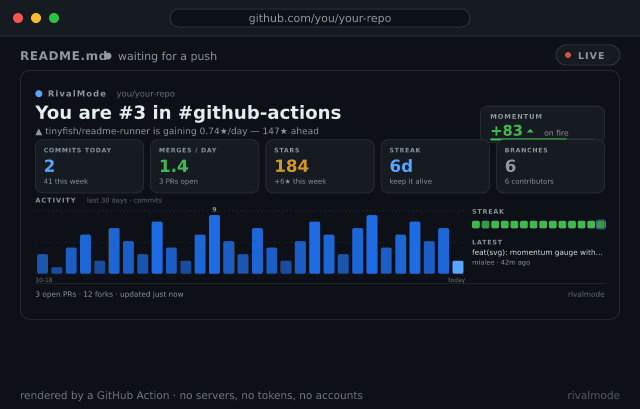
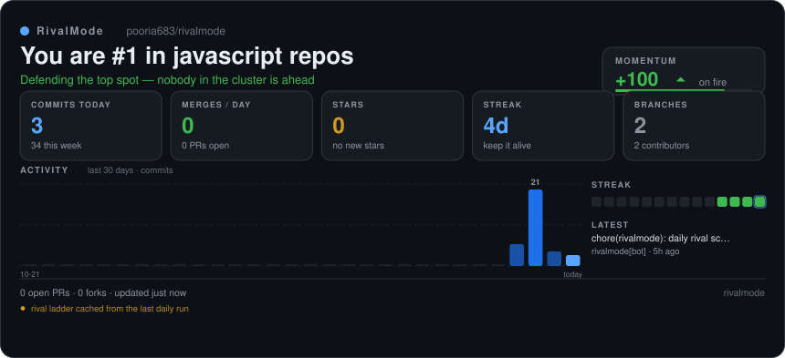
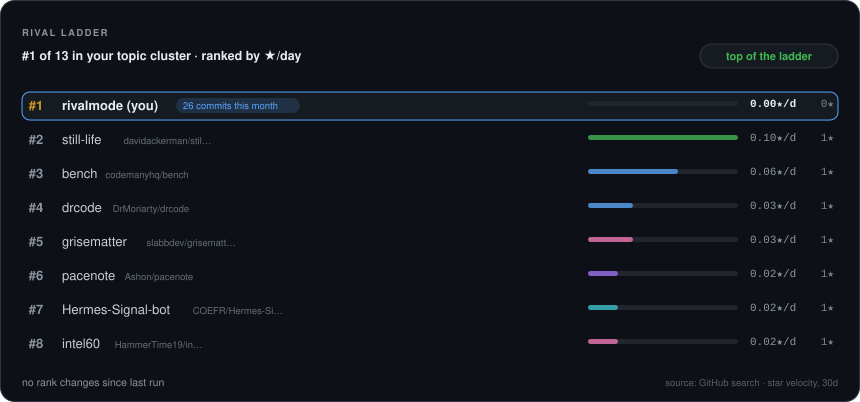
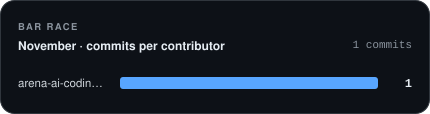
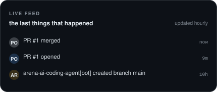
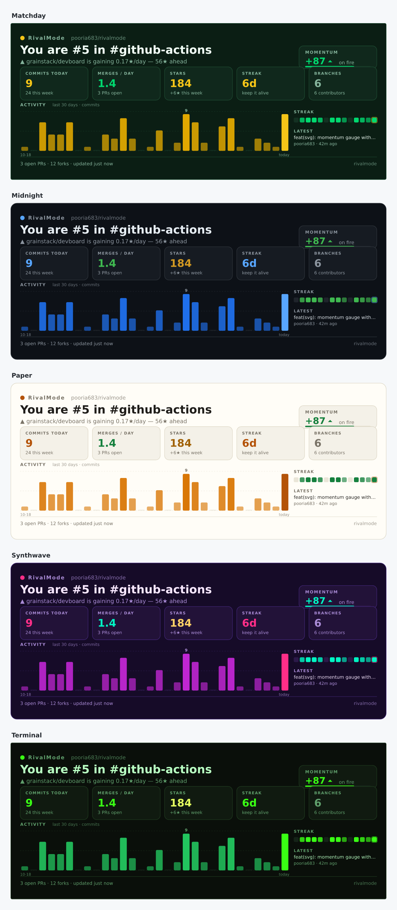

# ⚔️ RivalMode

**Your README should be alive.** RivalMode turns any GitHub repository into a
live scoreboard: commits, merges, stars, streaks — and the repos coming for your
spot. Every number is drawn into your own README by a GitHub Action. No servers,
no accounts, no API keys, no secrets beyond the `GITHUB_TOKEN` you already have.

<a href="https://github.com/pooria683/rivalmode/generate"></a>



<sub>The real card, rendered by the real code — a push moves the numbers, then a
rival overtakes and the README tells you about it.</sub>

---

## Quick start

1. Click **Use this template** (or fork).
2. That's it.

The `RivalMode scoreboard` workflow runs on your first push, renders the cards,
writes them into `assets/rivalmode/`, commits the result as
`rivalmode[bot]`, and your README has a live scoreboard. It costs nothing and
needs no setup — the workflow ships with the template.

Add topics to your repo (`Settings → Topics`). Topics are what put you in a
cluster, and the cluster is the game.

<details>
<summary>Prefer to install it into an existing repo by hand?</summary>

```bash
git clone https://github.com/pooria683/rivalmode /tmp/rivalmode
cd /path/to/your-repo
node /tmp/rivalmode/src/cli.mjs setup        # writes config, workflows, README markers
node /tmp/rivalmode/src/cli.mjs scoreboard --mock   # optional: preview with sample data
git add -A && git commit -m "chore: install rivalmode"
```

Uninstall is the inverse and removes exactly what it added:

```bash
node /tmp/rivalmode/src/cli.mjs uninstall --dry-run   # see what would go
node /tmp/rivalmode/src/cli.mjs uninstall             # strip README sections, delete .rivalmode/
```
</details>

---

## What you get

### The scoreboard

| Card | What it answers |
|:--|:--|
| **Scoreboard** | Am I ahead or behind? Momentum, ranks, today vs this week, activity chart, streak |
| **Rival ladder** | Who is ahead of me, by how much, and who is gaining fastest |
| **Bar race** | Who on the team is actually shipping, this month |
| **Event feed** | What just happened — pushes, stars, forks, releases |
| **Badges** | Momentum, rank, streak, weekly points, licence |

### How the game works

| Action | Points | Why it's worth that |
|:--|--:|:--|
| **Commit** | **2** | The basic unit of progress. Small enough that you can always score |
| **Pull request merged** | **10** | A commit that survived review |
| **Issue closed** | **4** | Finishing things counts |
| **Star gained** | **5** | Someone outside the repo noticed |
| **Fork** | **8** | Someone is betting their own repo on yours |
| **Release shipped** | **25** | The thing is real |
| **Day on a commit streak** | **3** per day | Consistency beats heroics (capped at 14 days) |
| **Beating a rival** | **25** | Passing someone is the point |
| **Being passed** | **−12** | Losing your spot should sting |

### Momentum is the number that matters

Momentum is not your score — it is **how this week compares to last week**, on a
−100…+100 scale:

```
ratio = (this week's points) / (last week's points)
momentum = 50 × log₂(ratio)      clamped to −100…+100
```

Doubling your week is `+50`. Halving it is `−50`. Four times the activity is
`+100`, and a dead week is `−100`. It is logarithmic on purpose: one enormous
week cannot make a repo look unstoppable forever, and a genuinely quiet week
does not look like a catastrophe. A trivial week is capped at `+40`, because one
commit after a dead week is not "on fire".

### Who counts as a rival

RivalMode looks for three kinds of rival, every day:

- **Forks that out-commit you.** Compared with the compare API — a fork ahead of
  upstream is the purest possible rivalry.
- **Repos in your topic cluster**, within roughly one order of magnitude of your
  star count. Being "#4,000 in `github-actions`" against Kubernetes is true and
  useless; being **#4 of 12 repos your own size** is a game you can win this
  month. Brand-new repos, archived repos, and profile READMEs are filtered out.
- **Your stargazers** — people who starred you and are shipping their own repos.

Rivals are ranked by **star velocity** (★/day over 30 days), tie-broken by total
stars, then commits. A rival needs *measured* velocity to share your ladder: a
repo we could only guess at never outranks you on a guess.

---

## Live demo: this repo

RivalMode is its own first user. Everything below is generated by the workflows
in `.github/workflows/`, hourly and daily.

<!-- rivalmode:start badges -->


<!-- rivalmode:end badges -->

<!-- rivalmode:start scoreboard -->


**You are #1 of 13 in your topic cluster.** ⚠️ `IsDerky/homelab` is gaining faster than you (0.09★/day vs 0). Hold the line.

**Momentum +43** ▲ heating up · 1 commits this week vs 0 last week

> [!NOTE]
> Some numbers are stale this run — rival ladder cached from the last daily run

<sub>updated just now · every number comes from the GitHub API, nothing is hand-edited</sub>
<!-- rivalmode:end scoreboard -->

## The ladder

<!-- rivalmode:start rivals -->


**You are the top of the ladder.** The next repo has to come for you.
<!-- rivalmode:end rivals -->

## This month

<table><tr><td valign="top">

<!-- rivalmode:start team -->


🥇 **arena-ai-coding-agent[bot]** leads this month with **1 commits** (1 all-time).
<!-- rivalmode:end team -->

</td><td valign="top">

<!-- rivalmode:start feed -->


- `9h` [arena-ai-coding-agent\[bot\] created branch main](https://github.com/undefined)
<!-- rivalmode:end feed -->

</td></tr></table>

## Recent conquests

<!-- rivalmode:start conquests -->
_Nothing conquered yet this month. Open a PR — it pays 10 points._
<!-- rivalmode:end conquests -->

---

## Themes

Look is a config value, not a rewrite. Five ship in the box:

| Theme | Vibe |
|:--|:--|
| `midnight` | GitHub-native dark. Default |
| `synthwave` | Neon magenta and cyan, glowing bars |
| `terminal` | Phosphor green, scanlines, CRT |
| `matchday` | Stadium green with a gold accent |
| `paper` | Warm light theme for light READMEs |

<div align="center">

</div>

```bash
node src/cli.mjs setup --theme=synthwave
# or change one line in .rivalmode/config.json
```

A theme is a JSON file with eleven colours. See
[CONTRIBUTING.md](CONTRIBUTING.md) — new themes are the easiest useful
contribution there is.

---

## Templates for your kind of project

The cluster you land in depends on your topics. Pick the closest category when
you set up — the topics do the rest:

| Category | Suggested topics | Typical cluster |
|:--|:--|:--|
| **App** | `web-app` `nextjs` `saas` | full products, mostly star-driven |
| **CLI** | `cli` `command-line-tool` `developer-tools` | utilities, velocity is spiky |
| **Skill / bot** | `ai` `llm` `agent` `automation` | fast-moving, weekly rank churn |
| **Site / docs** | `documentation` `awesome-list` `static-site` | slow, steady, star-heavy |
| **Library** | `library` `sdk` `typescript` | merges and releases dominate |

Set them once:

```json
{ "rivals": { "fallbackTopics": ["cli", "developer-tools"] } }
```

---

## How it works

```
.github/workflows/
  scoreboard.yml   hourly  — repo numbers, cards, README (commit as rivalmode[bot])
  rivals.yml       daily   — forks, topic cluster, fans, re-rank the ladder
  weekly-recap.yml Monday  — friendly week-in-review, posted as an issue comment
  rivalmode-setup.yml      — install + first scoreboard in one run

src/
  cli.mjs            commands: scoreboard / rivals / recap / setup / uninstall / doctor
  pipeline.mjs       collect → score → render → write
  render.mjs         all cards from one snapshot
  render_readme.mjs  the marker-spliced README
  lib/github.mjs     REST client: ETags, retries, rate-limit awareness
  lib/collect.mjs    one flat snapshot of the repo
  lib/rivals.mjs     discovery: forks, topic neighbours, fans, peer band
  lib/score.mjs      points, momentum, cluster ranking
  svg/               hand-written SVG: scoreboard, rivals, bars, feed, badges
themes/              eleven-colour JSON files
.rivalmode/          config.json + committed state (rivals, momentum history, feed)
```

**The README is the UI, and it is the only UI.** Everything RivalMode writes
lives between markers:

```markdown
<!-- rivalmode:start scoreboard -->
...generated, do not edit...
<!-- rivalmode:end scoreboard -->
```

Everything outside those markers is yours. Regeneration is idempotent: if
nothing changed, nothing is committed. A second identical run writes zero bytes.

### The weekly recap

Every Monday the workflow posts a week-in-review comment on a single pinned
issue — points earned, the contributor of the week, momentum change, rivals
gained and lost, and one honest line about how the week went:

> **🔥 The roast**
> `nova-labs/repo-hype` passed you this week. You shipped 18 commits; they
> shipped more. Consider this a formal challenge.

Roasts are always about the repo's own public numbers, never about a person.

---

## Privacy and safety

- **Public data only.** Your repo's own events, plus public search. Nothing else.
- **No tracking, no analytics, no third parties.** No requests leave GitHub.
- **Rate-limit aware.** Conditional requests with ETags and a committed cache;
  the hourly job usually costs a handful of API calls. Search runs once a day.
- **Private repos work in degraded mode.** Your own numbers render normally;
  rival search is disabled, and the card says so instead of inventing a rank.
- **Failures are visible, not silent.** If a fetch fails, the card carries one
  honest line about it. RivalMode never converts an error into a `0`.
- **Uninstall is `rm -rf .rivalmode`** plus stripping the markers — one command,
  no residue.

---

## Contributing

Community themes are the whole point of the visual layer — the cards are
plain SVG generated from a colour file, so a new look is a 20-line JSON file and
zero code. [CONTRIBUTING.md](CONTRIBUTING.md) has the theme contract, the
golden-test workflow, and the local dev loop.

```bash
npm test                     # 82 fixture-based tests, no network
npm run demo                 # regenerate the README GIF
node tools/preview.mjs --png # render every card in every theme
```

---

<sub>MIT licensed. Built to be forked, themed, and beaten by the repo one place
above you.</sub>

<!-- rivalmode:start footer -->
<sub>⚔️ [RivalMode](https://github.com/pooria683/rivalmode) · theme `midnight` · generated 2026-11-17 03:21 UTC · pooria683/rivalmode · [uninstall is deleting one folder](https://github.com/pooria683/rivalmode#uninstall)</sub>
<!-- rivalmode:end footer -->
